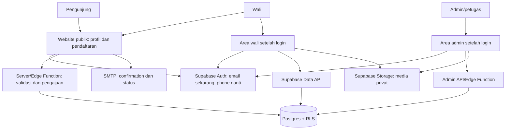
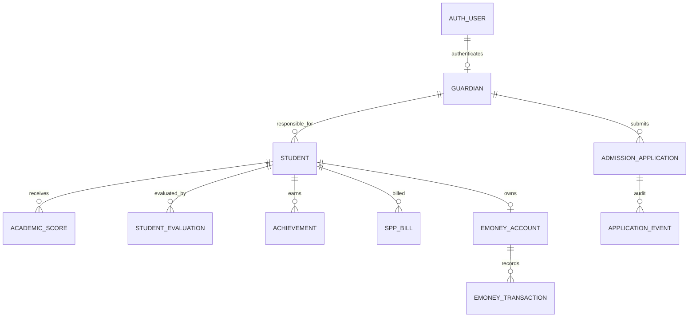

# 02. Arsitektur, Data, dan Keamanan

## Target Bentuk Sistem

**Prinsip batas:** browser memakai publishable key dan akses terbatas RLS. Service-role/secret key hanya boleh di Edge Function atau backend yang dikuasai server. Public website tidak pernah diberi hak membaca tabel `students` atau `guardians` secara bebas.

## Rancangan Entitas

### Entitas Yang Sudah Ada

- `auth.users`: kredensial dan session yang dikelola Supabase Auth.
- `guardians`: profil wali, email/telepon terdaftar, `auth_user_id`.
- `students`: identitas pokok santri dan guardian owner melalui `guardian_id`.
- `academic_scores`, `student_evaluations`, `student_attendance`, `student_discipline_records`, `achievements`, `spp_bills`, `emoney_accounts`, `emoney_transactions`, `guardian_notifications`, `albums`, `news_events`, `teachers`.

`student_attendance` menyimpan presensi harian per santri dan tanggal. `student_discipline_records` menyimpan catatan pembinaan/pelanggaran. Keduanya memiliki RLS baca untuk wali pemilik santri; perubahan data harus melalui jalur admin tepercaya. Baris demonstrasi ditandai `is_demo` dan harus ditampilkan sebagai simulasi, bukan sebagai catatan resmi.

### Entitas Target Yang Belum Dibangun

- `admission_applications`: data pengajuan publik yang masih menunggu review; simpan status, contact, data pokok calon santri, submitted/review timestamps, dan keputusan. Hindari menyimpan dokumen sensitif jika tidak wajib.
- `admission_application_events`: audit append-only untuk perubahan status, aktor petugas, waktu, dan alasan aman.
- `guardian_student_links` (opsional fase lanjut): relasi many-to-many jika ibu/ayah/wali lain harus memiliki akses. Sampai itu disepakati, gunakan `students.guardian_id` yang ada.
- `admin_profiles` atau `user_roles`: pemetaan user Auth ke role/permission yang ditulis hanya oleh jalur admin tepercaya; jangan memakai `user_metadata` buatan client untuk otorisasi.

Diagram target memasukkan beberapa relasi konseptual; tabel `ADMISSION_APPLICATION`, `APPLICATION_EVENT`, dan `AUTH_USER` adalah target/managed service, bukan semua tabel SQL yang sudah dibuat.

## Aktivasi Email Wali Saat Ini

1. Admin/website memasukkan email aktif ke `guardians.email` hanya setelah data disetujui.
2. Signup aplikasi membuat Auth user email/password dan mengirim confirmation link.
3. Auth session baru tersedia setelah email terkonfirmasi.
4. Implementasi lokal terbaru hanya menampilkan suggestion siswa yang terlihat melalui policy email RLS setelah konfirmasi email; wali memilih record dan tanggal lahir dicocokkan sebelum linking. Perubahan UI ini belum di-deploy atau diuji end-to-end.
5. Aplikasi mengubah hanya `guardians.auth_user_id` ke Auth UID saat ini.
6. Login berikutnya mengambil wali melalui `auth_user_id`; RLS membatasi semua data anak.

Untuk produksi, sebaiknya pindahkan linking final ke endpoint server/RPC terkontrol dan tambah rate limit/audit, terutama setelah alur web admissions selesai.

## Matriks Akses

| Aktor | Akses target |
| --- | --- |
| Anon/pengunjung | Halaman publik; mengirim pengajuan melalui endpoint tervalidasi; tidak membaca data siswa/guardian |
| Authenticated wali belum tertaut | Hanya record guardian yang email-nya terkonfirmasi dan tercatat; hanya anak milik record itu untuk verifikasi |
| Wali tertaut | SELECT data milik sendiri dan anak terkait; hanya operasi tulis yang diperlukan fitur dan dibatasi row ownership |
| Petugas admissions | Review/update aplikasi pendaftaran melalui role spesifik; tidak melihat data keuangan/medis kecuali hak kerja mengharuskan |
| Admin akademik/keuangan | Akses berdasarkan role dan scope; audit perubahan penting |
| Service role | Server-side saja, secrets tidak pernah dikirim ke browser |

## Klasifikasi Data

- **Publik:** profil pesantren, program, fasilitas, berita yang disetujui, kontak resmi.
- **Internal:** status pengajuan, catatan review, data operasional yang tidak dipublikasikan.
- **Pribadi:** nama, tanggal lahir, email/telepon wali, alamat, foto.
- **Sangat sensitif:** riwayat kesehatan, password, token Auth, credential SMTP/payment, biometrik, detail transaksi.

Jangan pernah menyimpan password wali sendiri; Supabase Auth mengelolanya. Hindari mencetak email lengkap/nomor/nama anak di log analytics. Untuk test, gunakan data buatan kecuali wali meminta penggunaan data personal tertentu.

## Kesiapan Produksi

- Set custom SMTP dengan sender pada domain yang dikuasai; atur SPF, DKIM, dan DMARC.
- Tambahkan Site URL dan redirect URLs production serta localhost yang diperlukan.
- Enforce email confirmation; jangan mematikan verifikasi untuk mempermudah demo.
- Perketat redirect agar tidak menggunakan wildcard luas di production.
- Jalankan Security Advisor dan uji RLS sebagai anon, wali yang benar, dan wali lain.
- Pisahkan migration SQL dari perubahan manual Dashboard dan catat setiap migration pada repository.
- Tetapkan backup, retention, incident response, dan prosedur revoke session.
